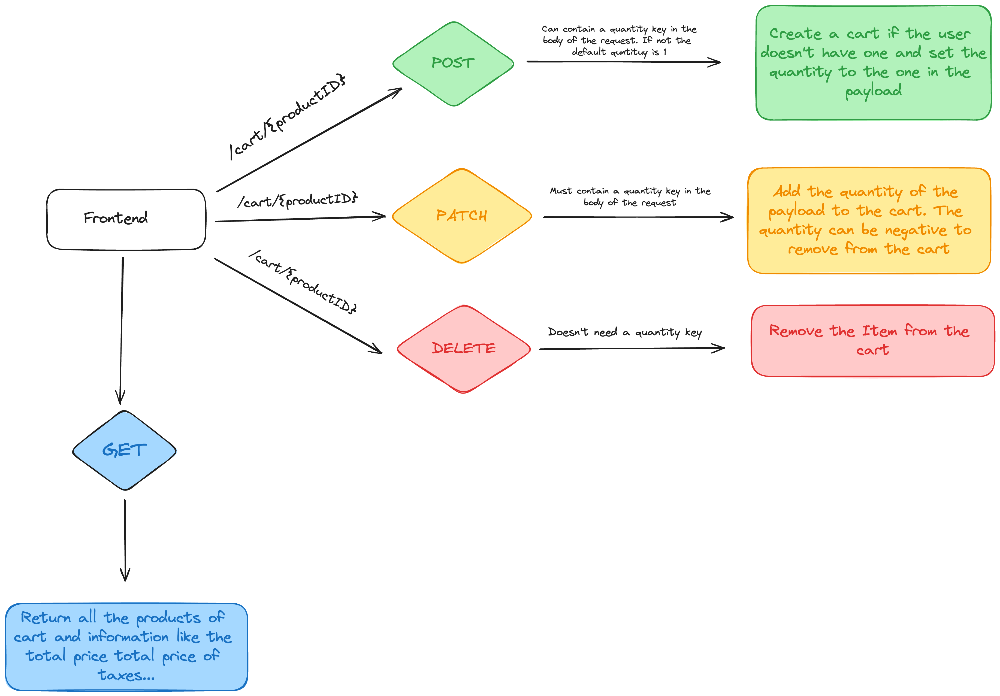

# Dive-in: Cart API documentation

Author : Barnabé PILLIAUDIN  
Date : 2024-05-06

# SUMMARY:

Proposition of a cart system.

# Context :

As a furniture seller, we want the customer to be able to buy products on our website.  
In order to do so we need to implement a cart system.  
We need the user to be able to add multiple products to his cart, remove them, update the quantity.  
We also need to be able to calculate the total price of the cart.

# Proposition of cart system

## Schema: of api calls

### Precisions

- A select request will be done to know if the user already have a cart or not.
- The cart for a user that is not logged in will be handled later.

## How it will be store in DB

We already have a table `Order`. We will use it to store the carts.  
A cart will be an order with a `FinalizedAt` field set to null.  
When the user will finalize his cart, we will set the `FinalizedAt` field to the current date.

We will create a new table `CartProducts` to store the relation between the order and the products.
This table will have a `quantity` field to store the quantity of the product in the cart.
It will also have a relation to ONE cart and ONE product.

The `Order` table currently has a relation to products. We will replace this relation by the `CartProducts` table.
