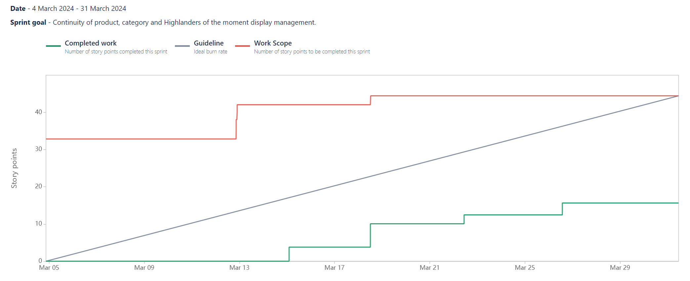

# Sprint N°3 [04/03/2024 - 01/04/2024]

_Continuity of product, category and Highlanders of the moment display management._

## Positive reviews

- Review 1

  - Description: There has been an improvement in the review.
  - Commitment:
    - Said by: Cédric
    - What: Continuing in this direction.
    - When: Until the end of the project.

- Review 2

  - Description: We have made good progress in backend to data management.
  - Commitment:
    - Said by: Kylian
    - What: Continue to to stay serious.
    - When: Until the end of the project.

- Review 3

  - Description: We're on the right track.
  - Commitment:
    - Said by: Barnabé
    - What: Continue to be curious and courageous.
    - When: Until the end of the project.

## Negative reviews

- Review 1

  - Description: Be more precise during the review.
  - Consequences: We can't really understand what we have to do in the review.
  - Commitment:
    - Said by: Cédric
    - What: Try to be more specific when we do a review so, that we can give more details.
    - When: During the fourth Sprint (#4)

- Review 2

  - Description: Too much rest before starting to allocate US.
  - Consequences: We had to hurry to be on time.
  - Commitment:
    - Said by: Barnabé
    - What: Be more reactive to allocate US more quickly and have more time to do them.
    - When: During the fourth Sprint (#4).

- Review 3

  - Description: Despite improvements in reviews, PRs are still a little too open.
  - Consequences: We'll wait a little longer before concluding our review.
  - Commitment:
    - Said by: Barnabé
    - What: Try to be a little more reactive to review.
    - When: During the fourth Sprint (#4).

- Review 4

  - Description: It took us a little while to get started on the review, but we're catching up well.
  - Consequences: We had to hurry and didn't have time to do everything.
  - Commitment:
    - Said by: Kylian
    - What: Try to be more reactive for the next sprint.
    - When: During the next Sprint (#4).

## Questions

No questions for this Sprint.

## Ideas

No ideas for this Sprint.

# Burnup Report

This overview of the Burnup report allows us to visualise the work accomplished during a sprint and compare it to the total scope of the sprint.

We've taken a long time to get started, which is why the curve doesn't rise at the beginning until 13 March.
From 13 March onwards, we started to allocate the US and to do them. We've made up a lot of ground and the curve is rising.

## Participants

- Barnabé
- Kylian
- Magali
- Cédric
- Alix

