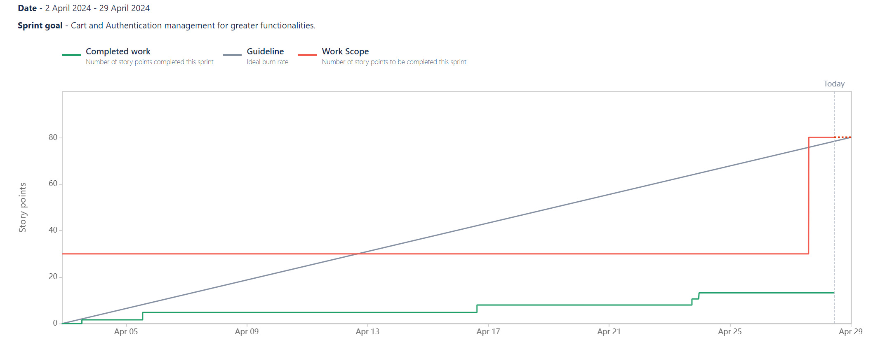

# Sprint N°4 [01/04/2024 - 29/04/2024]

_Cart and Authentication management for greater functionalities._

## Positive reviews

- Review 1

  - Description: Strengths still present and code quality still used.
  - Commitment:
    - Said by: Cédric
    - What: Continuing in this direction.
    - When: Until the end of the project.

- Review 2

  - Description: Easier to use Jira for developers
  - Commitment:
    - Said by: Kylian
    - What: Continue to use Jira seriously.
    - When: Until the end of the project.

- Review 3

  - Description: Efforts were made by some people, especially the PO, who made an effort to make a US.
  - Commitment:
    - Said by: Barnabé
    - What: Continue to be courageous.
    - When: Until the end of the project.

## Negative reviews

- Review 1

  - Description: Team demotivated, fewer reviews.
  - Consequences: Rules changed in github to 1 reviewer.
  - Commitment:
    - Said by: Cédric
    - What: Trying to hold on until the end.
    - When: During the fifth Sprint (#5)

- Review 2

  - Description: No major new features.
  - Consequences: It's not moving fast and it's demotivating.
  - Commitment:
    - Said by: Barnabé
    - What: Try to be a little more reactive and motivate ourselves to achieve our goal.
    - When: During the fifth Sprint (#5).

- Review 3

  - Description: Not much feedback from some people.
  - Consequences: We don't know where we stand and we're moving too slowly because we're waiting for answers.
  - Commitment:
    - Said by: Kylian
    - What: Try to be more reactive for the next sprint and give more news.
    - When: During the fifth Sprint (#5).

## Questions

No questions for this Sprint.

## Ideas

No ideas for this Sprint.

# Burnup Report

You can see that it took us a long time to get started on the tasks because the whole team was demotivated that month, so it was very complicated to get started.

But from 17 April onwards, we started to become more motivated and we were able to catch up. From 25 May to 29 April we worked on authentication, it was a pain but it was done with a lot of work.

## Participants

- Barnabé
- Kylian
- Magali
- Cédric
- Alix
