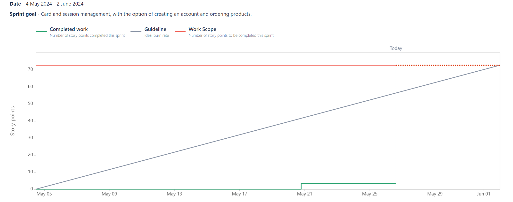

# Sprint N°5 [30/04/2024 - 27/05/2024]

_Cart and session management, with the option of creating an account and ordering products._

## Positive reviews

- Review 1

  - Description: Well organised oral presentation.
  - Commitment:
    - Said by: Cédric
    - What: Continuing in this direction to the end.
    - When: Until the end of the project.

- Review 2

  - Description: Jira was very well organised and saved us a lot of time.
  - Commitment:
    - Said by: Kylian
    - What: Continue to use Jira seriously.
    - When: Until the end of the project.

- Review 3

  - Description: Despite difficulties with authentication, it was successfully completed.
  - Commitment:
    - Said by: Barnabé
    - What: Continue to be courageous.
    - When: Until the end of the project.

- Review 4

  - Description: A united team that doesn't hesitate to help each other out.
  - Commitment:
    - Said by: Magali
    - What: Continue to be like this.
    - When: Until the end of the project.

## Negative reviews

- Review 1

  - Description: Major authentication problems.
  - Consequences: Time lost for other US.
  - Commitment:
    - Said by: Cédric
    - What: We should've estimated that the task would took longer than expected as there was a lot reworks done. There should've been a better scoping phase. (Why did we not attack the auth first?)
    - When: During the last Sprint (#6)

- Review 2

  - Description: Hashicorp has changed its authentication system of Vault.
  - Consequences: A minor rework was carried out on the Vault, which wasted a lot of time.
  - Commitment:
    - Said by: Barnabé
    - What: Better management of more complex US.
    - When: During the last Sprint (#6).

- Review 3

  - Description: One less member in the last two sprints.
  - Consequences: More work and a new organisation of 4 instead of 5.
  - Commitment:
    - Said by: Kylian
    - What: Organising in teams of 4.
    - When: During the last Sprint (#6).

## Questions

No questions for this Sprint.

## Ideas

No ideas for this Sprint.

# Burnup Report

As you can see, it took us a long time to get started because the whole team was demotivated this month, like last month, so it was very difficult to get started. It took us a long time to get organised for the oral presentation.

But from 21 May onwards, we started to get more motivated and we were able to catch up, especially on authentication.

## Participants

- Barnabé
- Kylian
- Magali
- Cédric
